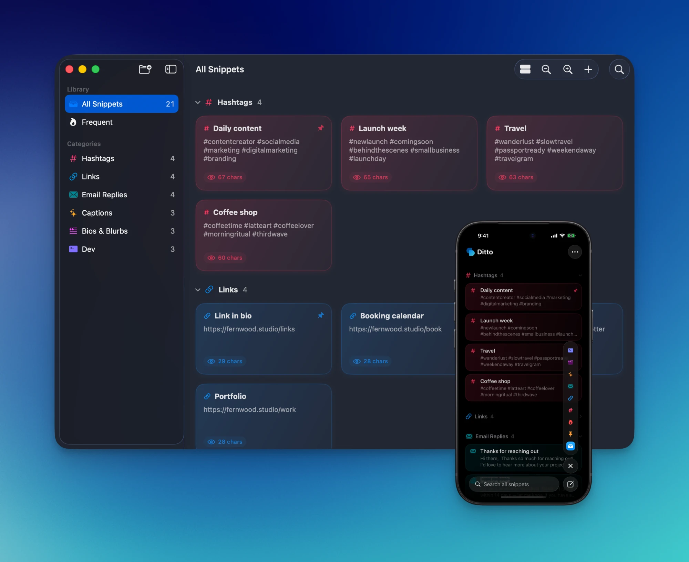

<p align="center"></p>

<h1 align="center">Ditto</h1>

Ditto keeps the text you paste all the time (hashtags, links, bios, email replies, templates) in one place on your Mac and iPhone. Sort snippets into color-coded categories, click one to copy it, and search from the menu bar.

<p align="center"></p>

## What it does

- **Click to copy**: snippets are cards; click one and it's on your clipboard.
- **Categories**: give each category its own color and icon. Group the grid by category or date added, and collapse sections you don't need.
- **Menu bar search** (Mac): click the Ditto icon for instant search-and-copy from anywhere. Copy text elsewhere and paste it into Ditto to start a new snippet.
- **Frequent and pinned**: the snippets you copy most rise to the top, and you can pin the ones you always want close.
- **Share links**: copy a `ditto://` link for a snippet or a whole category. Anyone who opens it adds those snippets to their library. Re-opening a link is safe: Ditto merges by name and skips duplicates.
- **Import and export**: back up or move your whole library as a JSON file.
- **Shortcuts and Spotlight**: copy and create snippets with App Intents, and find snippets from Spotlight.
- **Native on both platforms**: SwiftUI and SwiftData, with zoomable cards on Mac and a category rail on iPhone.

## Requirements

- macOS 26 or later
- iOS 26 or later
- Xcode 26 to build

## Build from source

Ditto currently ships as source.

The easiest route on a Mac is to double-click **Build Ditto.command** in Finder. It builds an ad-hoc signed Release build (no Apple account needed), installs it to `/Applications`, and launches it.

To build in Xcode instead:

```sh
open Ditto.xcodeproj
```

Pick the `Ditto` scheme for the Mac app or the iOS scheme for iPhone, then choose your own team under *Signing & Capabilities*. The iOS simulator works without a team. To run on a real iPhone, also change the bundle ID (`com.danielmccullum.ditto.ios`) to one of your own.

## Import links

Ditto registers a `ditto://` URL scheme:

- `ditto://add?content=…&title=…&category=…` adds a single snippet.
- `ditto://import?data=…` adds a bundle of snippets and/or whole categories.

See [docs/ditto-link-prompt.md](docs/ditto-link-prompt.md) for a prompt that makes any LLM generate these links, and [.claude/skills/ditto-import-spec](.claude/skills/ditto-import-spec) for the full format.

## License

Copyright (c) 2026 Daniel McCullum.

Ditto is free software: you can redistribute it and/or modify it under the terms of the [GNU General Public License](LICENSE) as published by the Free Software Foundation, either version 3 of the License, or (at your option) any later version. It is distributed in the hope that it will be useful, but without any warranty; see the license for details.
